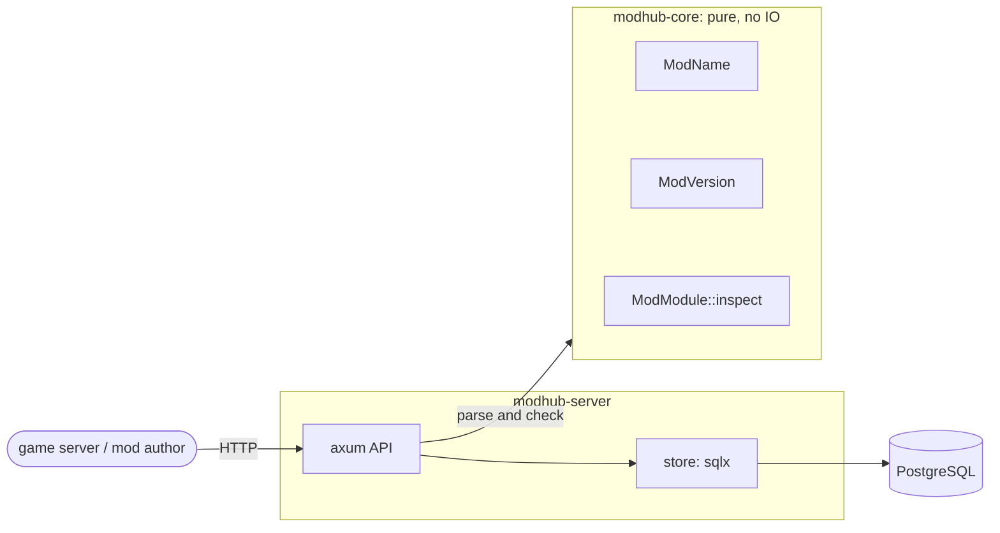

# modhub

[](https://github.com/AestroFidelium/modhub/actions/workflows/ci.yml)
[](https://codecov.io/gh/AestroFidelium/modhub)
[](https://app.codspeed.io/AestroFidelium/modhub?utm_source=badge)
[](Cargo.toml)
[](#license)

A registry for [Stormlight](https://github.com/AestroFidelium/stormlight-sdk) WASM mods:
publish a mod, version it, validate it against the mod ABI, and serve it to game servers.

Every upload is checked against the game's own mod contract before it is stored, so
a server never downloads a mod its engine would refuse to load.

> This repository is a read-only mirror of a private upstream, where development
> and planning happen. Bug reports and feedback are welcome as
> [issues](https://github.com/AestroFidelium/modhub/issues); pull requests
> are disabled.



The HTTP layer only parses requests into `modhub-core` types; every rule a request is
checked against lives in the core crate, which does no IO and is tested in isolation.

## Run

With [Nix](https://nixos.org) (flakes):

```sh
tools/pg start          # local PostgreSQL on a unix socket under .pg/
nix run                 # listens on 127.0.0.1:8080
```

Without Nix: a PostgreSQL to point `DATABASE_URL` at, `rustup`, `clang` and
[`mold`](https://github.com/rui314/mold) (the configured linker), then
`SQLX_OFFLINE=true cargo run --release -p modhub-server`. Migrations run on startup.

Publish the example mod from the test fixtures:

```sh
curl -X POST localhost:8080/mods -H 'content-type: application/json' -d '{"name":"example"}'
curl -X PUT localhost:8080/mods/example/versions/1.0.0 \
     -H 'content-type: application/wasm' \
     --data-binary @crates/core/tests/fixtures/example_mod.wasm
```

```json
{
  "name": "example",
  "version": "1.0.0",
  "sha256": "11396bb31d9c8902a96940ce4b20bf576784023fc2a7a9adead10780fb3b7f62",
  "size": 162755,
  "entry_points": ["handle", "trigger", "tick"]
}
```

```sh
curl localhost:8080/mods/example/versions              # {"name":"example","versions":["1.0.0"]}
curl -o example.wasm localhost:8080/mods/example/versions/1.0.0
```

| Variable | Default | |
| --- | --- | --- |
| `DATABASE_URL` | required | `postgres://` or `postgresql://` URL |
| `MODHUB_LISTEN` | `127.0.0.1:8080` | `IP:port` |
| `RUST_LOG` | `info,sqlx=warn` | log filter; logs go to stderr |

Stops on SIGTERM or Ctrl-C after in-flight requests finish.

## API

| Method | Path | Does |
| --- | --- | --- |
| `POST` | `/mods` | register `{"name": "gpu-cloth"}` → `201` |
| `PUT` | `/mods/{name}/versions/{version}` | publish the `application/wasm` body → `201` with its `sha256`, size and entry points |
| `GET` | `/mods/{name}/versions/{version}` | download → `200 application/wasm`, `ETag` = SHA-256, cached as immutable |
| `GET` | `/mods/{name}/versions` | versions, lowest precedence first → `200` |

Releases are immutable: a version is published once (`409 version_exists` after) and
always serves the same bytes. The SHA-256 stored with a module is checked on every
download; a mismatch is a `500`, never a corrupt module.

Errors are JSON with a stable machine-readable code; branch on `error`, not on `message`:

```json
{"error": "version_exists", "message": "`example` 1.0.0 is already published, and releases are immutable"}
```

## The mod contract

A module is accepted when the game's host could load it:

- valid WebAssembly 2.0 (no threads, no shared memory, no components), at most 8 MiB;
- **no imports at all**: mods run with no WASI and no host calls;
- exports `memory` (initial size within the host's 64 MiB) and `mod_register: () -> i64`;
- any of `mod_handle`, `mod_trigger`, `mod_tick` it exports have the host's signatures,
  and come with `mod_alloc: (i32) -> i32`.

Export names come from the game's own ABI crate (`stormlight_mod_abi`), and the real
example mod is part of the test suite.

## Numbers

Release build, loopback, i5-10400F (6 cores), PostgreSQL 18 on the same machine
(`tools/pg`, fsync off). Reproduce with `nix build && tools/load.sh` and
`cargo bench -p modhub-core`.

| What | Result |
| --- | --- |
| Download the 159 KiB example mod, 16 connections | ~4,900 req/s (~780 MB/s), p50 3.1 ms, p99 5.8 ms |
| List versions, 16 connections | ~45,000 req/s, p50 0.32 ms, p99 0.80 ms |
| Publish the 159 KiB mod (contract check, SHA-256, insert), one at a time | p50 4.1 ms, p99 5.6 ms |
| Contract check alone (`ModModule::inspect`) | ~225 MB/s: 0.62 ms for the example mod, 37 ms at the 8 MiB limit, linear in code size |

## How it is tested

Test-first, and every test is a property or fuzz test on
[bolero](https://github.com/camshaft/bolero), no hand-picked examples:

- **Model-based**: random sequences of registrations, publications, listings and
  downloads run against PostgreSQL and against an in-memory model, step by step; the
  same at the HTTP level, including malformed, oversized and cut-off uploads.
- **Contract oracle**: generated `.wasm` modules (imports, memories, globals, every
  value type in signatures) checked against an independent statement of the mod
  contract; the real example mod and every cut of it as fixtures.
- **The binary as a process**: startup failures, SIGTERM/SIGINT, and no password in logs.
- **Fuzzing** of every parser of external input (`tools/fuzz_night.sh`), and
  **mutation testing** (`tools/mutants_night.sh`): no surviving mutants.
- 100 % line and branch coverage but one unreachable defensive branch
  (`cargo llvm-cov nextest --branch`).

## Layout

| Crate | Holds |
| --- | --- |
| `crates/core` (`modhub-core`) | Pure domain: names, versions, and `ModModule`, the check of a `.wasm` against the Stormlight mod contract. No IO. |
| `crates/server` (`modhub-server`) | HTTP API (axum) over a PostgreSQL store (sqlx, compile-time checked queries). |

## Development

```sh
direnv allow        # or: nix develop
tools/pg start      # local PostgreSQL on a unix socket under .pg/ (the gate starts it too)
cargo t             # tests (nextest)
tools/gate all      # everything CI checks (plus coverage, benches and MSRV in CI)
tools/fuzz_night.sh 10m     # fuzz campaign → crashes/LATEST.md
tools/mutants_night.sh 10m  # mutation testing → mutants/LATEST.md
```

Tests are property and fuzz tests on [bolero](https://github.com/camshaft/bolero),
checked for holes with [cargo-mutants](https://mutants.rs).

## License

Licensed under either of [Apache License 2.0](LICENSE-APACHE) or
[MIT license](LICENSE-MIT), at your option.
